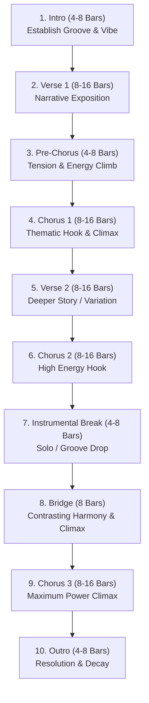

# Song Structure & Section Architecture Guide

Every commercial, emotional, and memorable song relies on a deliberate balance of familiarity and variation. A song is not merely a continuous sequence of chords; it is an emotional journey constructed through distinct functional sections.

---

## The 7 Core Musical Sections

| Section | Typical Bars | Energy Level (1-10) | Primary Function | Vocal & Instrumental Characteristics |
|---|---|---|---|---|
| **Intro** | 4 – 8 | 2 – 4 | Establish key, tempo, mood, and core sonic motif | Minimal or vocal hooks/ad-libs. Sets atmospheric expectation. |
| **Verse** | 8 – 16 | 4 – 6 | Deliver narrative, context, and exposition | Lower pitch range, rhythmic, conversational, lower harmonic density. |
| **Pre-Chorus** | 4 – 8 | 6 – 8 | Build tension and anticipate the chorus | Rising chord progression, ascending vocal line, drum build/snare roll. |
| **Chorus** | 8 – 16 | 8 – 10 | The thematic climax and unforgettable hook | Highest register, full instrumentation, maximum dynamic power, repetitive lyrics. |
| **Bridge** | 4 – 8 | 5 – 7 | Contrast, perspective shift, or revelation | New chord progression, altered key/scale, stripped back or explosive change. |
| **Instrumental Break** | 4 – 8 | 7 – 9 | Showcase virtuosity, groove, or motif variation | Guitar solo, synth lead riff, brass blast, or drum fill breakdown. |
| **Outro** | 4 – 8 | 2 – 5 | Closure, resolution, or atmospheric fade-out | Repeating hook motif, decreasing density, sustained decay or fade. |

---

## 1. Intro (Introduction)
- **Purpose**: Captures listener attention within the first 5 seconds. Establishes the rhythmic groove, tempo, chord foundation, and instrumentation.
- **Arrangement**: Usually features a simplified rhythm track, an ambient pad or guitar arpeggio, or a short preview of the chorus melody (the "teaser").
- **Vocal Delivery**: Primarily instrumental, or spoken word, vocal humming, sighs, or iconic catchphrases.
- **Timing Rule**: In 4/4 time at 120 BPM, a 4-bar intro lasts exactly 8.0 seconds; at 135 BPM it lasts 7.11 seconds.

## 2. Verse (Storytelling & Exposition)
- **Purpose**: Moves the narrative forward. Introduces characters, setting, conflict, or intimate emotional states.
- **Musical Characteristics**: Harmonic backing is kept clean to leave spectral space for vocal intelligibility. The chord progression is steady and supportive.
- **Vocal Delivery**: Mid-register, conversational phrasing, steady rhythmic cadence. Verse 2 typically deepens the story with slightly more instrumental layers (e.g., adding hi-hats or counter-melodies).

## 3. Pre-Chorus (The Lift / Transition)
- **Purpose**: Bridges the intimate verse with the explosive chorus. Ramps up tension and sonic momentum.
- **Musical Characteristics**: Rhythmic acceleration (e.g., doubling hi-hat frequency or building snare rolls). Harmonic suspension (often resolving on the V or IV chord to demand resolution).
- **Vocal Delivery**: Rising vocal pitch, shorter phrases, urgent diction, vocal compression, and breath anticipation.

## 4. Chorus (The Anchor & Climax)
- **Purpose**: The most memorable, emotionally intense part of the song containing the central lyrical theme and melodic hook.
- **Musical Characteristics**: Maximum dynamic velocity, full wall-of-sound orchestration (double-tracked guitars/synths, layered bass, four-on-the-floor kick, or heavy drum accents).
- **Vocal Delivery**: Full chest voice or powerful belt, highest pitch contour in the song, multi-part harmonies, wide dynamic range (**ff**).

## 5. Bridge (The Perspective Shift)
- **Purpose**: Prevents monotony after two verse-chorus cycles. Offers a harmonic, emotional, or lyrical revelation before the final climax.
- **Musical Characteristics**: Drops the standard progression for contrasting chords (e.g., modulating to the relative major/minor or flat-VI). May strip drums entirely (breakdown) or surge into half-time groove.
- **Vocal Delivery**: Either intimate, vulnerable falsetto/head voice or an intense, raw belt climbing towards the song's highest note.

## 6. Instrumental Break (Solo / Groove Interlude)
- **Purpose**: Allows the listener to absorb the musical energy without vocal distraction. Celebrates instrumental musicianship and sonic texture.
- **Musical Characteristics**: Featured instrument takes center stage: distortion guitar solo in Rock/Metal, cowbell/synth lead in Phonk, saxophone in Jazz, sitar in Indian Fusion, or synthesizer drop in EDM.

## 7. Outro (Coda / Resolution)
- **Purpose**: Brings the musical journey to a satisfying conclusion, whether through a fade-out, a clean dramatic cutoff, or a gradual breakdown of instruments.
- **Musical Characteristics**: Stripping elements one by one until only a single instrument (e.g. acoustic guitar, decaying synth reverb, or solo piano note) remains.
- **Vocal Delivery**: Ad-lib riffs, repeating the song title hook softly, whispering, or sustained final notes fading into silence.

---

## Canonical Arrangement Flow Chart

